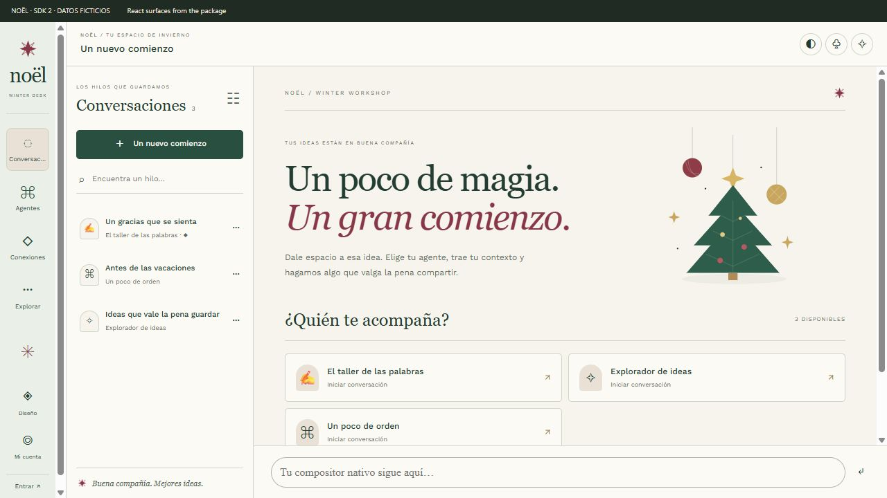

# Noël · Winter Workshop (`v2.0.1`)

Una plantilla navideña open source para **Urano Desktop & Urano Web · Template SDK 2**.
Verde abeto, papel marfil, borgoña y latón. ES/EN, claro/oscuro y movimiento reducido, diseñada con una arquitectura modular y desacoplada.



[Modo oscuro](docs/noel-dark.png) · [Historial móvil](docs/noel-mobile.png)

## Qué incluye (`v2.0.1`)

- **Nieve estática y atmósfera de invierno**: nieve en las esquinas del compositor (más visible al minimizarlo), paleta verde abeto (`--bg: #17261f` en oscuro / `#f7f4ed` en claro) aplicada también al área de conversación en Desktop y Web, y scrollbars nativos estilizados.
- **Tema completo del host**: fuente `Work Sans` local embebida y texto de carga personalizado.
- **Cuatro superficies React propias (`navigation`, `header`, `history`, `welcome`)**, conectadas con los modelos y acciones reales de Urano mediante SDK 2:
  - **Navegación contextual (Riel compacto de 88px y Sidebar expandido de 248px)**:
    - Renderizado dinámico de **iconos vectoriales reales de Lucide (`iconNodes`)** extraídos de cada módulo y submenú del host, con respaldo semántico (`SvgIcon`).
    - **Tarjeta de Contexto de Módulo (`ModuleContextCard`)**: al entrar a un módulo (`UranoAI`, `SalesAgent`, `CRM`, etc.), muestra el encabezado del módulo activo, botón directo para volver a Inicio y sus submenús organizados.
    - **Tarjeta de Identidad de Usuario (`UserIdentityCard`)** en modo Inicio con avatar de iniciales, estado de sesión y nombre del negocio.
    - **Secciones colapsables (`CollapsibleNavSection`)** con jerarquía visual clara (divisor tipográfico limpio cuando la sección está abierta y pastilla con contador cuando está contraída) y buscador integrado en tiempo real.
  - **Header con controles nativos en línea**: conserva los controles reales de cada pantalla del host directamente en la barra superior sin encerrarlos en modales secundarios.
  - **Historial con Selector de Agentes buscable (`AgentPickerPopover`)**:
    - Popover estilo `MultiPurposePopover` al pulsar **«Un nuevo comienzo» / «New conversation»**, con buscador instantáneo, pestañas de filtro (`Todos`, `Agentes`, `Plugins`) y navegación completa por teclado (`↑`, `↓`, `Enter`, `Esc`).
    - Búsqueda de conversaciones, fijado (`pin`), indicador de tareas programadas y eliminación con confirmación del host.
  - **Bienvenida (`Welcome`)**: lienzo editorial con buscador de agentes e inicio rápido de conversación.
- **Panel React independiente (`Noël · Taller de invierno`)**: seis recetas bilingües de prompts (`reflect`, `create`, `organize`), filtros por categoría, copia rápida y checklist de cierre en memoria.

---

## Arquitectura Modular del Proyecto

El código de interfaz en `ui/components/` sigue una arquitectura modular por responsabilidades inspirada en `ModuleArchitecture.md`:

```text
ui/
├── Workshop.jsx                              # Entrypoint del runtime real (SDK 2)
├── preview.jsx                               # Galería local de desarrollo (con datos ficticios)
└── components/
    ├── SurfaceApp.jsx                        # Orquestador raíz de las 4 superficies
    ├── surfaceStyles.js                      # Barrel que ensambla las hojas de estilo modulares
    ├── Workshop.jsx                          # Panel adicional "Noël · Taller de invierno"
    ├── recipes.js                            # Catálogo bilingüe (ES/EN) de recetas de prompts
    ├── nativeScroll.js                       # Estilos de scrollbars nativos
    ├── styles.js                             # Estilos del panel Workshop
    ├── config/
    │   └── i18n.js                           # Helpers puros de etiquetas e iniciales
    ├── icons/
    │   ├── LucideNodes.jsx                   # Renderizador seguro de vectores Lucide (iconNodes)
    │   ├── SvgIcon.jsx                       # Biblioteca de iconos SVG de respaldo
    │   └── resolveNavIcon.jsx                # Resolución declarativa de iconos de navegación
    ├── surfaces/
    │   ├── navigation/
    │   │   ├── useNavigationModel.js         # Hook de estado, búsqueda y agrupación de menús
    │   │   ├── ModuleContextCard.jsx         # Tarjeta de encabezado cuando estás en un módulo
    │   │   ├── UserIdentityCard.jsx          # Tarjeta de perfil/workspace en modo Inicio
    │   │   ├── CollapsibleNavSection.jsx     # Secciones colapsables de submenús
    │   │   └── Navigation.jsx                # Superficie principal del sidebar (88px / 248px)
    │   ├── header/
    │   │   └── Header.jsx                    # Superficie de cabecera contextual
    │   ├── history/
    │   │   ├── useAgentPicker.js             # Hook de búsqueda, tabs y teclado del selector
    │   │   ├── AgentPickerPopover.jsx        # Popover buscable de agentes y plugins
    │   │   ├── ThreadRow.jsx                 # Fila de sesión con pin y menú contextual
    │   │   └── History.jsx                   # Superficie de historial de conversaciones
    │   └── welcome/
    │       └── Welcome.jsx                   # Superficie de bienvenida y directorio de agentes
    └── styles/
        ├── tokens.js                         # Variables CSS (claro/oscuro), resets y scrollbars
        ├── navigationStyles.js               # Estilos del riel compacto y sidebar expandido
        ├── headerStyles.js                   # Estilos de cabecera
        ├── historyStyles.js                  # Estilos del historial y AgentPickerPopover
        ├── welcomeStyles.js                  # Estilos del lienzo de bienvenida
        └── responsiveStyles.js               # Media queries y prefers-reduced-motion
```

---

## Instalación

### Desde el Marketplace o archivo ZIP (Urano Desktop y Web)
1. En **Urano Desktop**, abre **Marketplace → Plantillas** e instala **Noël · Winter Workshop**, o ve a **Mi entorno → Plantillas → Instalar ZIP** y selecciona `release/urano-noel-2.0.1.zip`.
2. Pulsa **Usar plantilla** en la tarjeta **Noël · Winter Workshop**.
3. En la barra lateral, usa el botón de expandir/colapsar (`Explorar`) para alternar entre el riel compacto (88px) y el menú completo con submenús de módulos (248px).
4. Para volver al diseño original en cualquier momento: **Mi entorno → Plantillas → Urano · Original** (o atajo de recuperación nativa **Ctrl/Cmd + Alt + Shift + U**).

---

## Desarrollo con Dev Link

En **Mi entorno → Plantillas → DEV TOOLS → Vincular carpeta**, selecciona esta carpeta (que contiene `template.json`). Urano revalida el Dev Link automáticamente cada ~2 segundos.

```powershell
npm install
npm run build
npm test
```

Para recompilar automáticamente `ui/bundle.js` al editar cualquier módulo React o estilo:

```powershell
npm run watch
```

> **Nota:** Requiere Node.js compatible con Vite 8 (Node 22.12+ o LTS posterior).

---

## Galería local (sin Urano)

```powershell
npm run preview
```

- Abre la URL local de Vite para probar todas las superficies con datos de demostración.
- Parámetros soportados:
  - `/?theme=dark&lang=en` o `/?theme=light&lang=es`
  - `?surface=navigation`, `?surface=header`, `?surface=history`, `?surface=welcome` o `?surface=panel`

---

## Generar el paquete ZIP de distribución

```powershell
npm run build
npm test
npm run pack
```

Genera `release/urano-noel-2.0.1.zip` validando que el número total de archivos y tamaño cumplan estrictamente los límites de seguridad del SDK (`<= 256` archivos, sin dependencias, cachés ni acceso a APIs privadas del host).

---

## Privacidad, Seguridad y Licencia

- **Aislamiento SDK 2**: El paquete corre en frames aislados sin acceso directo a `electronAPI`, `localStorage`, `sessionStorage`, red ni credenciales. Solo recibe metadatos autorizados por el host y emite intenciones mediante `sdk.act(...)`.
- **Licencia**: Código y arte original bajo licencia **MIT** (`LICENSE`). Tipografía `Work Sans` bajo licencia **SIL OFL** (`THIRD_PARTY_LICENSES.md`).
- **Documentación adicional**:
  - [Guía de creación de plantillas](../../UranoDesktop/docs/CREATE_TEMPLATE_GUIDE.md)
  - [Reglas visuales y de diseño](DESIGN.md)
